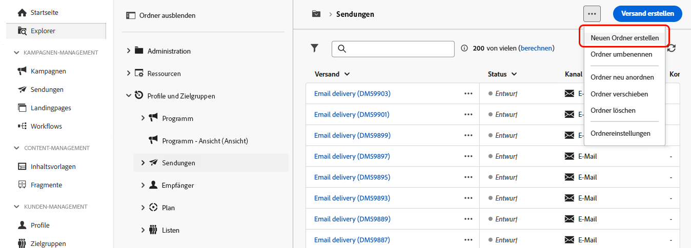
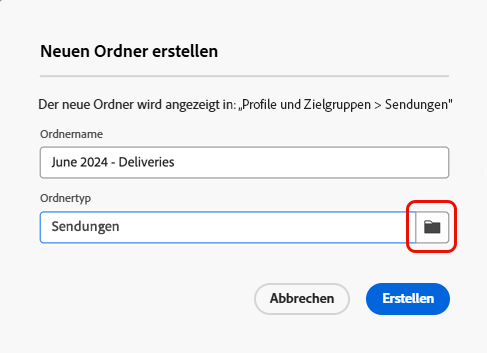
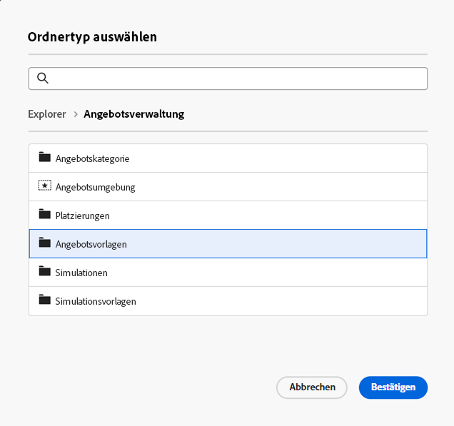

# Erstellen und Verwalten eines Ordners

In Adobe Campaign können Sie neue Ordner erstellen, um Ihren Navigationsbaum zu verwalten. Navigieren Sie dazu im **[!UICONTROL Explorer]** zu dem Ordner, in dem Sie Ihren neuen Ordner erstellen möchten.

Wählen Sie unter der Schaltfläche **[!UICONTROL …]** die Option **[!UICONTROL Neuen Ordner erstellen]** aus.

{zoomable="yes"}

Wenn Sie einen neuen Ordner erstellen, ist der Ordnertyp standardmäßig vom selben Typ wie der übergeordnete Ordner.\
In diesem Beispiel wird ein Ordner im Ordner **[!UICONTROL Sendungen]** erstellt.

{zoomable="yes"}

Sie können den Ordnertyp ändern, indem Sie auf das Symbol „Ordnertyp“ klicken und einen Typ aus der angezeigten Liste auswählen.

{zoomable="yes"}

Richten Sie den Ordnertyp ein, indem Sie auf die Schaltfläche **[!UICONTROL Bestätigen]** klicken.

Um einen Ordner ohne bestimmten Typ zu erstellen, wählen Sie den Typ **[!UICONTROL Allgemeiner Ordner]** aus.

In der Adobe Campaign-Konsole wird die Erstellung und Verwaltung von Ordnern [hier](https://experienceleague.adobe.com/de/docs/campaign/campaign-v8/config/configuration/folders-and-views) erläutert. Sie können auch Berechtigungen für Ordner einrichten. [Weitere Informationen](https://experienceleague.adobe.com/de/docs/campaign/campaign-v8/admin/permissions/folder-permissions?lang=de).