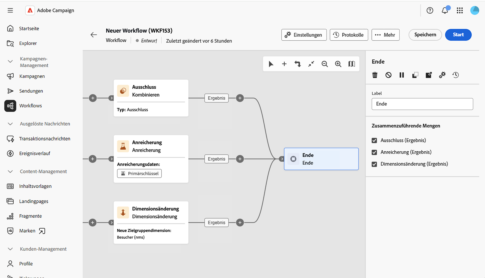

# Ende {#end}

>[!CONTEXTUALHELP]
>id="acw_orchestration_end"
>title="Endaktivität"
>abstract="Mit der Aktivität **Ende** können Sie das Ende eines Workflows grafisch markieren. Wenn mehr als eine eingehende Transition verfügbar ist, den Abschnitt **Zusammenzuführende Mengen** verwenden, um auszuwählen, welche Transitionen mit der Aktivität verbunden werden sollen."

>[!CONTEXTUALHELP]
>id="acw_orchestration_end_sets"
>title="Zusammenzuführende Mengen"
>abstract="Markieren Sie die vorherigen Aktivitäten, die als eingehende Transitionen der Aktivität **Ende** verbunden werden sollen. Die ausgewählten Aktivitäten werden dann mit der Aktivität **Ende** verbunden. Dieser Abschnitt wird nur angezeigt, wenn mehr als eine eingehende Transition für die Verbindung mit der Aktivität verfügbar ist."

>[!CONTEXTUALHELP]
>id="acw_orchestration_signal"
>title="Externes Signal"
>abstract="Platzhalter für den Abschnitt „Externes Signal“ in den Parametern der Endaktivität. Nur für orchestrierte Kampagnen verfügbar. NICHT LÖSCHEN"

Die Aktivität **Ende** ist eine Aktivität zur **Flusskontrolle**. Damit können Sie das Ende eines Workflows grafisch markieren. Diese Aktivität ist optional.

Die Aktivität unterstützt mehrere eingehende Transitionen, wenn mehr als eine eingehende Transition verfügbar ist.

Aktivieren Sie im Abschnitt **Zusammenzuführende Mengen** die vorherigen Aktivitäten, die Sie als eingehende Transitionen der Aktivität **Ende** verbinden möchten. Die ausgewählten Aktivitäten werden dann mit der Aktivität **Ende** auf der Workflow-Arbeitsfläche verknüpft.

